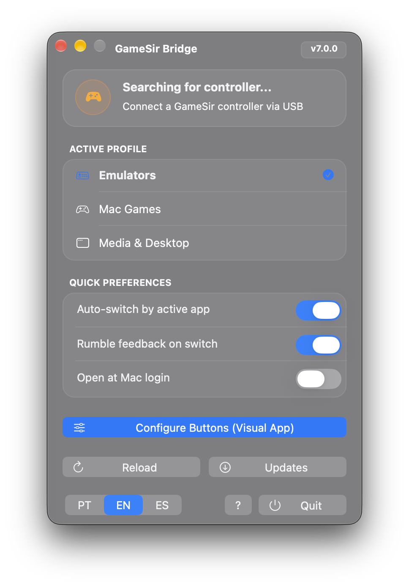
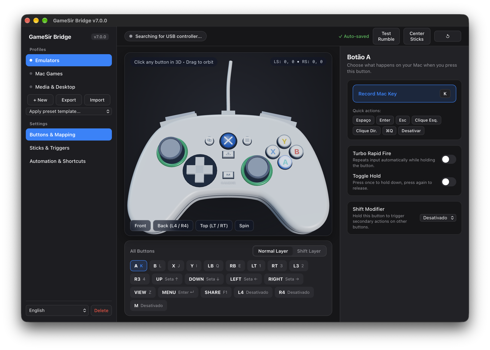

# GameSir Bridge for macOS (v7.0.0)

Userspace USB GIP (Gaming Input Protocol) driver, key/mouse mapper, and native macOS HUD app for **GameSir G7 SE**, **GameSir G7**, **GameSir G7 HE**, and **GameSir T4 Kaleid** on Apple Silicon & Intel Macs.

## Screenshots

| Native HUD | 3D Configurator |
| :---: | :---: |
|  |  |

## What's New in v7.0.0
- **Interactive 3D Controller Configurator:** Rotatable 3D model with camera angles (*Front*, *Rear (L4 / R4)*, *Top (LT / RT)*, *Spin*), base contact shadow, hover mapping tooltips, motor vibration test (*Testar Motores*), and analog centering (*Centralizar Analógicos*).
- **Refined Native macOS HUD & Icon:** Translucent HUD cards, quick-toggle switches (*Launch at Login*, *Rumble Feedback*, *Auto-switch by app*), unified friendly profile names, multi-language support (EN / PT / ES), and updated `AppIcon.icns`.
- **Zero-Dependency Standalone `.app` Releases:** Download the pre-built `.zip` from Releases, drag `GameSir Bridge.app` to `Applications`, and run immediately — no Python or Homebrew required.
- **Universal macOS Architecture & Path Support:** Automatic `libusb` resolution across standalone bundles, Apple Silicon (`/opt/homebrew`), and Intel (`/usr/local`), with user profiles stored safely in `~/Library/Application Support/GameSir Bridge/`.

## Features
- **Native Translucent macOS HUD & Embedded Configurator:** True `NSVisualEffectView` HUD window, Dock quick-switch menu, and an integrated 3D / visual configurator window.
- **Live Controller Telemetry & 3D Visualization:** Real-time interactive controller visualizer showing pressed buttons, analog stick vectors, deadzone rings, and trigger pressure bars.
- **Zero-Drift Analog Calibration:** One-click resting center calibration (`lx`, `ly`, `rx`, `ry` offsets) saved directly to `profiles.json`.
- **Shift Layer (Secondary Mappings):** Assign any button as a modifier to unlock a full second layer of actions per profile.
- **Per-Button Turbo (Rapid-Fire) & Toggle (Hold Lock):** Configure adjustable rapid-fire (2–40 Hz) or toggle locks on any button.
- **Press-to-Bind Recorder, Presets & JSON Import/Export:** Bind keys with a single keypress, load ready-made templates, or share profiles.
- **macOS Shortcuts Integration:** Trigger native macOS Shortcuts from any button or combo using `shortcut:Shortcut Name`.
- **Full Multi-Language UI:** English, Português, and Español across both the native macOS HUD and the Visual Configurator.

## Quick Shortcuts
- **VIEW + UP:** Cycle active profile (with floating HUD notification and controller rumble)
- **VIEW + DOWN:** Toggle Control Panel HUD
- **LB + Right Stick** (in Mouse mode): 2D Trackpad-style Scroll

## Installation

### Option 1: Standalone App (Recommended)
1. Download the latest `.zip` from the **Releases** page on GitHub.
2. Unzip and move `GameSir Bridge.app` into your `Applications` folder.
3. Grant Accessibility permission in **System Settings -> Privacy & Security -> Accessibility**.

### Option 2: From Source (Developer / Homebrew)
Requires macOS 12+, Python 3, and `libusb`:
git clone https://github.com/analogart/gamesir-g7-se-macos.git
cd gamesir-g7-se-macos
./install.sh
